[](LICENSE)


![Codex](https://img.shields.io/badge/Codex-000000?logo=data:image%2Fsvg%2Bxml;base64,PHN2ZyB4bWxucz0iaHR0cDovL3d3dy53My5vcmcvMjAwMC9zdmciIHZpZXdCb3g9IjAgMCAyNCAyNCIgZmlsbD0iI2ZmZmZmZiI%2BIDxwYXRoIGQ9Ik0yMi4yODE5IDkuODIxMWE1Ljk4NDcgNS45ODQ3IDAgMCAwLS41MTU3LTQuOTEwOCA2LjA0NjIgNi4wNDYyIDAgMCAwLTYuNTA5OC0yLjlBNi4wNjUxIDYuMDY1MSAwIDAgMCA0Ljk4MDcgNC4xODE4YTUuOTg0NyA1Ljk4NDcgMCAwIDAtMy45OTc3IDIuOSA2LjA0NjIgNi4wNDYyIDAgMCAwIC43NDI3IDcuMDk2NiA1Ljk4IDUuOTggMCAwIDAgLjUxMSA0LjkxMDcgNi4wNTEgNi4wNTEgMCAwIDAgNi41MTQ2IDIuOTAwMUE1Ljk4NDcgNS45ODQ3IDAgMCAwIDEzLjI1OTkgMjRhNi4wNTU3IDYuMDU1NyAwIDAgMCA1Ljc3MTgtNC4yMDU4IDUuOTg5NCA1Ljk4OTQgMCAwIDAgMy45OTc3LTIuOTAwMSA2LjA1NTcgNi4wNTU3IDAgMCAwLS43NDc1LTcuMDcyOXptLTkuMDIyIDEyLjYwODFhNC40NzU1IDQuNDc1NSAwIDAgMS0yLjg3NjQtMS4wNDA4bC4xNDE5LS4wODA0IDQuNzc4My0yLjc1ODJhLjc5NDguNzk0OCAwIDAgMCAuMzkyNy0uNjgxM3YtNi43MzY5bDIuMDIgMS4xNjg2YS4wNzEuMDcxIDAgMCAxIC4wMzguMDUydjUuNTgyNmE0LjUwNCA0LjUwNCAwIDAgMS00LjQ5NDUgNC40OTQ0em0tOS42NjA3LTQuMTI1NGE0LjQ3MDggNC40NzA4IDAgMCAxLS41MzQ2LTMuMDEzN2wuMTQyLjA4NTIgNC43ODMgMi43NTgyYS43NzEyLjc3MTIgMCAwIDAgLjc4MDYgMGw1Ljg0MjgtMy4zNjg1djIuMzMyNGEuMDgwNC4wODA0IDAgMCAxLS4wMzMyLjA2MTVMOS43NCAxOS45NTAyYTQuNDk5MiA0LjQ5OTIgMCAwIDEtNi4xNDA4LTEuNjQ2NHpNMi4zNDA4IDcuODk1NmE0LjQ4NSA0LjQ4NSAwIDAgMSAyLjM2NTUtMS45NzI4VjExLjZhLjc2NjQuNzY2NCAwIDAgMCAuMzg3OS42NzY1bDUuODE0NCAzLjM1NDMtMi4wMjAxIDEuMTY4NWEuMDc1Ny4wNzU3IDAgMCAxLS4wNzEgMGwtNC44MzAzLTIuNzg2NUE0LjUwNCA0LjUwNCAwIDAgMSAyLjM0MDggNy44NzJ6bTE2LjU5NjMgMy44NTU4TDEzLjEwMzggOC4zNjQgMTUuMTE5MiA3LjJhLjA3NTcuMDc1NyAwIDAgMSAuMDcxIDBsNC44MzAzIDIuNzkxM2E0LjQ5NDQgNC40OTQ0IDAgMCAxLS42NzY1IDguMTA0MnYtNS42NzcyYS43OS43OSAwIDAgMC0uNDA3LS42Njd6bTIuMDEwNy0zLjAyMzFsLS4xNDItLjA4NTItNC43NzM1LTIuNzgxOGEuNzc1OS43NzU5IDAgMCAwLS43ODU0IDBMOS40MDkgOS4yMjk3VjYuODk3NGEuMDY2Mi4wNjYyIDAgMCAxIC4wMjg0LS4wNjE1bDQuODMwMy0yLjc4NjZhNC40OTkyIDQuNDk5MiAwIDAgMSA2LjY4MDIgNC42NnpNOC4zMDY1IDEyLjg2M2wtMi4wMi0xLjE2MzhhLjA4MDQuMDgwNCAwIDAgMS0uMDM4LS4wNTY3VjYuMDc0MmE0LjQ5OTIgNC40OTkyIDAgMCAxIDcuMzc1Ny0zLjQ1MzdsLS4xNDIuMDgwNUw4LjcwNCA1LjQ1OWEuNzk0OC43OTQ4IDAgMCAwLS4zOTI3LjY4MTN6bTEuMDk3Ni0yLjM2NTRsMi42MDItMS40OTk4IDIuNjA2OSAxLjQ5OTh2Mi45OTk0bC0yLjU5NzQgMS40OTk3LTIuNjA2Ny0xLjQ5OTdaIiAvPiA8L3N2Zz4%3D)


[](https://x.com/amgauge)

# Jaz

**all your coding agents, living on the board.**

A personal AI on machines you own — any agent, loops that run overnight, boards,
memory, and git control. Client/server split, always-on, open source end to end.

## Guiding Principles

- Use the major coding agents. Frontier labs are investing heavily in coding agents and benchmarks. Jaz should reuse that work, not reinvent it.
- Bring your existing plans. Sign in with the ChatGPT, Claude, Kimi, Grok, Google, or Meta account you already have, with API keys and open-source agents alongside them.
- Unified memory that you control and can export.
- Connect core apps. Telegram, WhatsApp, Gmail, Calendar, and Slack should plug into the same owned context.
- Open source.

## Download
[<svg xmlns="http://www.w3.org/2000/svg" width="280" height="60" viewBox="0 0 280 60" role="img" aria-label="Download for macOS">
  <rect x="0.5" y="0.5" width="279" height="59" rx="13" fill="#1d1d1f" stroke="#3a3a3c" stroke-width="1"/>
  <g transform="translate(24,15.5) scale(1.2)" fill="#ffffff">
    <path d="M12.152 6.896c-.948 0-2.415-1.078-3.96-1.04-2.04.027-3.91 1.183-4.961 3.014-2.117 3.675-.546 9.103 1.519 12.09 1.013 1.454 2.208 3.09 3.792 3.039 1.52-.065 2.09-.987 3.935-.987 1.831 0 2.35.987 3.96.948 1.637-.026 2.676-1.48 3.676-2.948 1.156-1.688 1.636-3.325 1.662-3.415-.039-.013-3.182-1.221-3.22-4.857-.026-3.04 2.48-4.494 2.597-4.559-1.429-2.09-3.623-2.324-4.39-2.376-2-.156-3.675 1.09-4.61 1.09zM15.53 3.83c.843-1.012 1.4-2.427 1.245-3.83-1.207.052-2.662.805-3.532 1.818-.78.896-1.454 2.338-1.273 3.714 1.338.104 2.715-.688 3.559-1.701"/>
  </g>
</svg>](https://jaz.chat/download)

## Examples

**Every coding agent, one composer.** Codex, Claude, Kimi, Grok, OpenCode, Antigravity or Muse per thread, on the plans you already pay for.

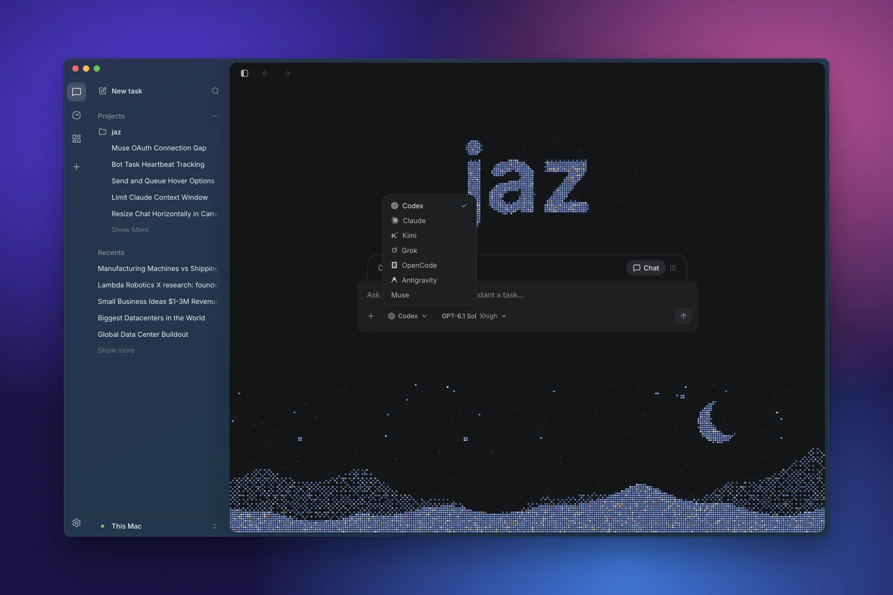

**Ultrathink.**

https://github.com/user-attachments/assets/16062e29-f4ae-4484-87ca-3a5977fac88b

**Canvas.** The agent keeps a live board of charts, tables and notes beside the chat.

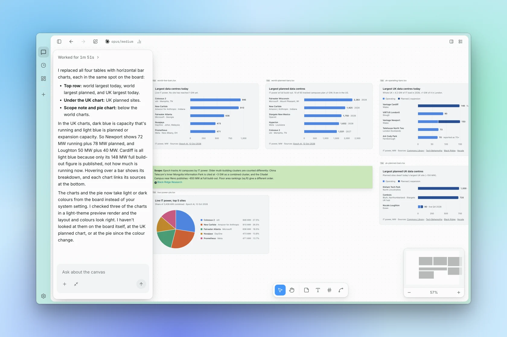

**Interactive visualisations.**


**Talk to your bots.** Voice mode in the chat, and a floating pill with a live transcript once the app is minimised.

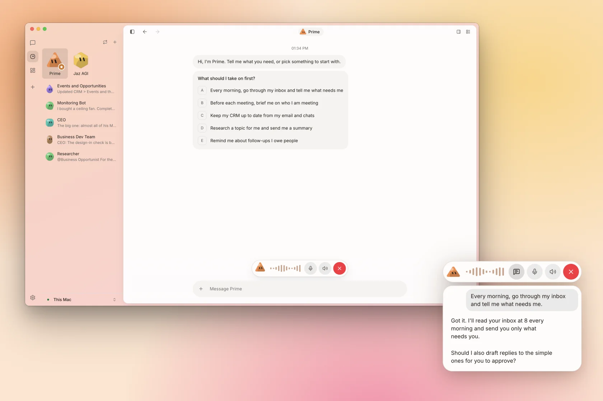

**Bots hand off work.** A bot delegates a fix to Codex, reviews it, merges it and reports back. Its tasks, routines and memory live in its panel.

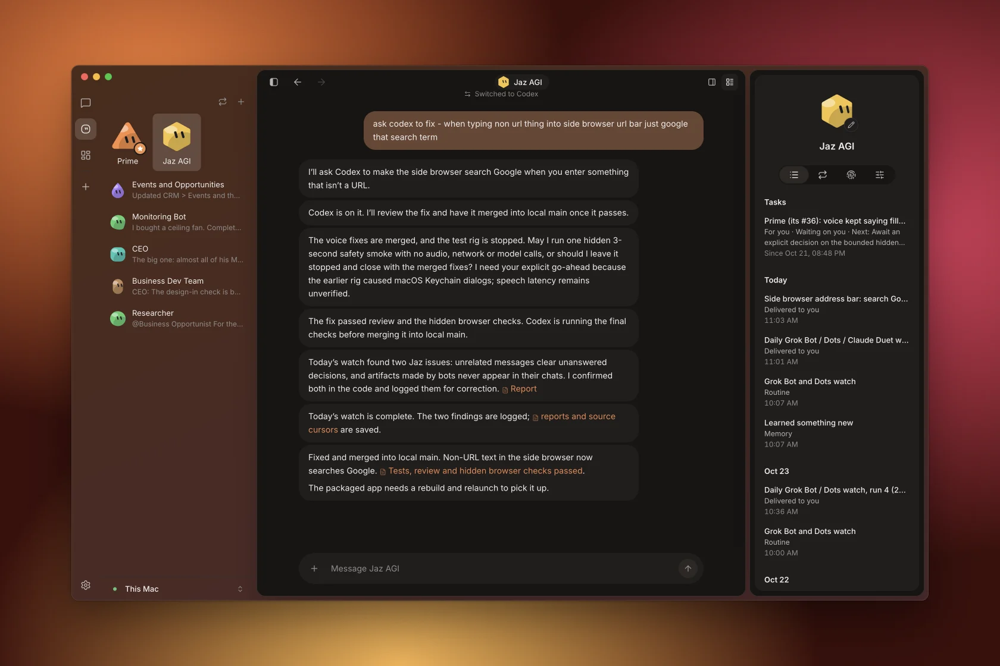

**Routines with real output.** A bot wakes every morning, checks sources and keeps a living document up to date.

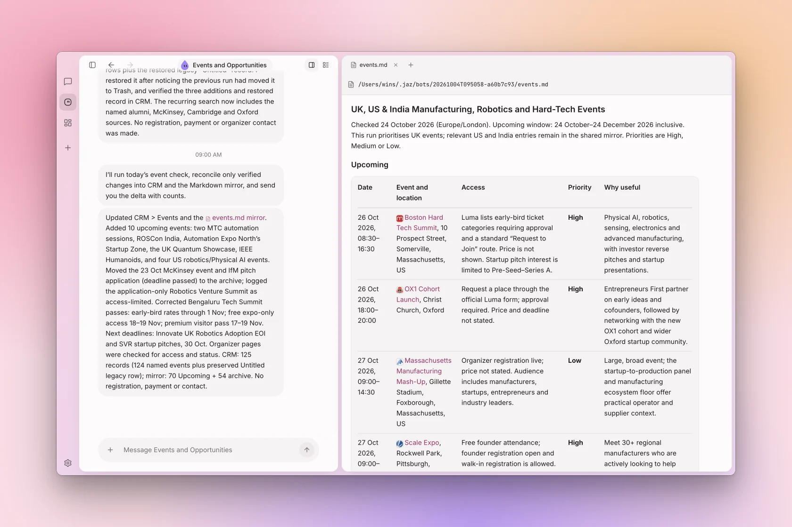

**Ship from the thread.** Inline diffs, commands and checks, on a worktree.

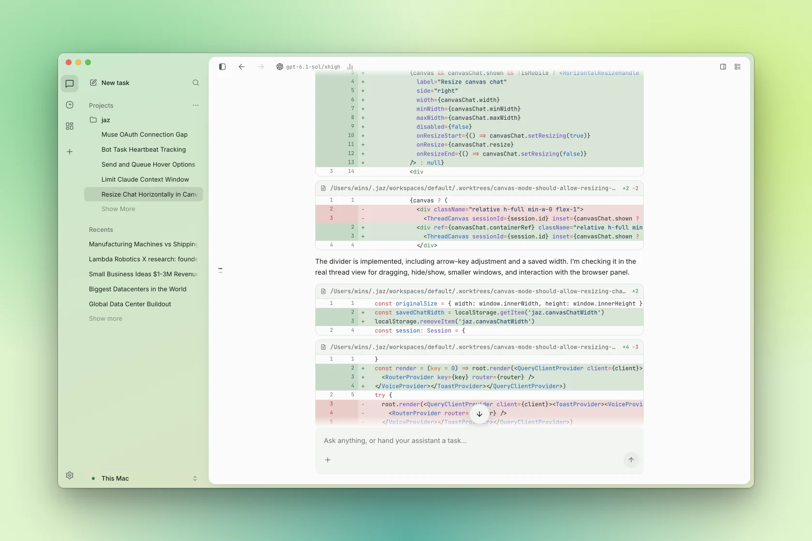

**Side panel.**

https://github.com/user-attachments/assets/de550dc1-75cc-43bb-aca0-f34c99573d47

**Connect every coding agent.** Sign in once per agent with your own account; Jaz runs them natively.

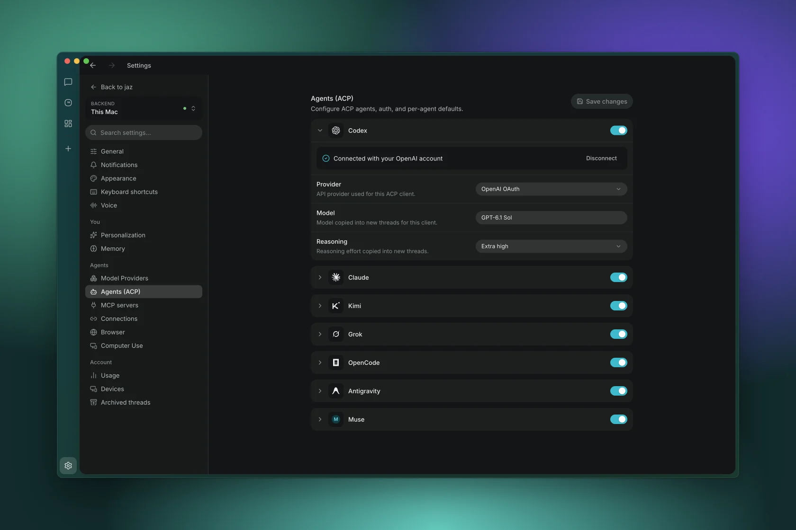

**Integrations.** Gmail, Calendar, Drive, Slack, Granola, WhatsApp and Telegram as agent tools and memory.

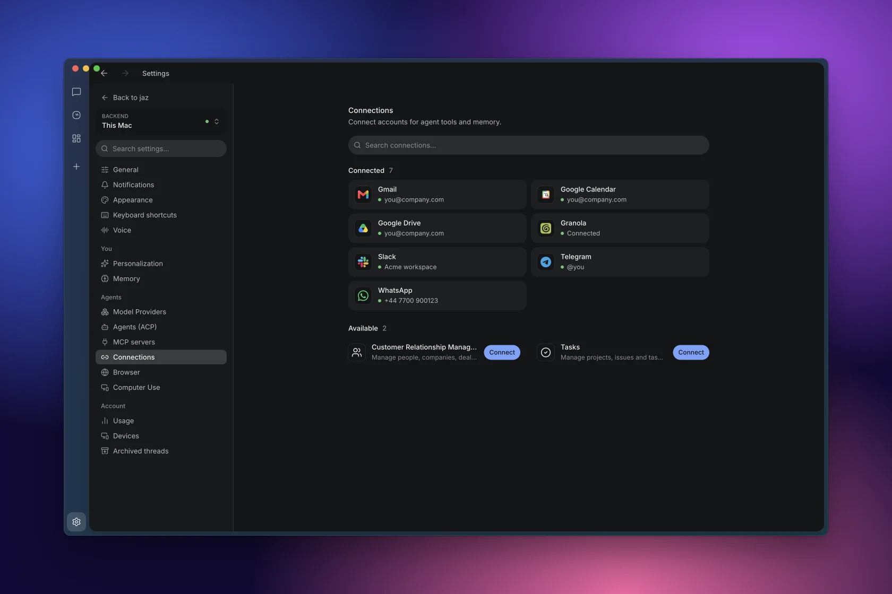

**CRM, built in.** Pipeline, people, companies and follow-ups that every agent can read and update.

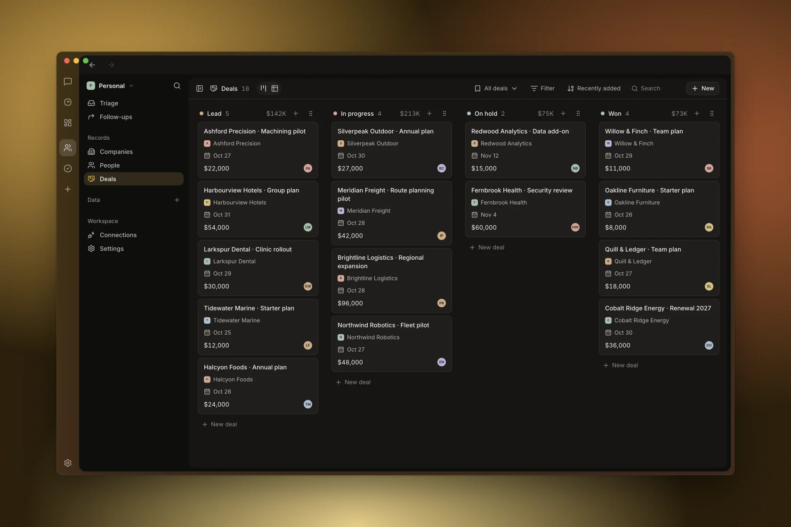

**Tasks, built in.** Issues, projects and cycles that every agent can plan and update.

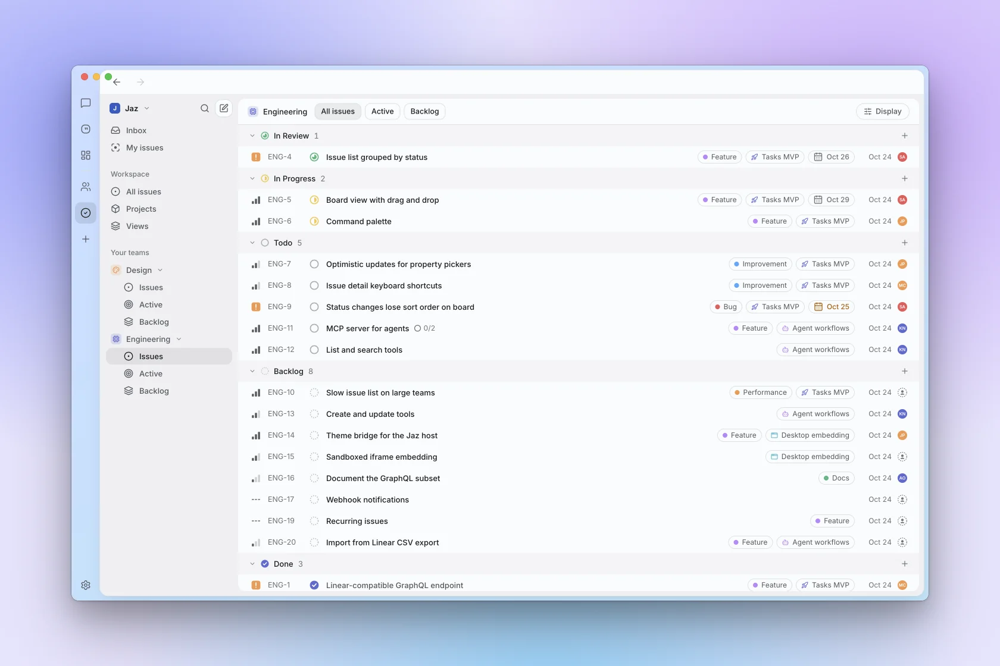

**Colour theme.** Up to three linked hues on a wheel, eight presets, film grain.

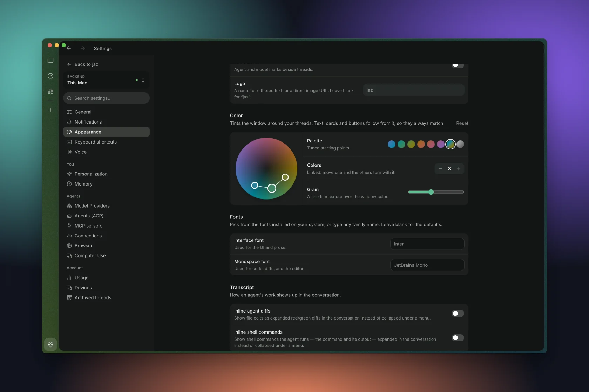

**Every colour, light and dark.** The window wash and the dithered home follow your hue.

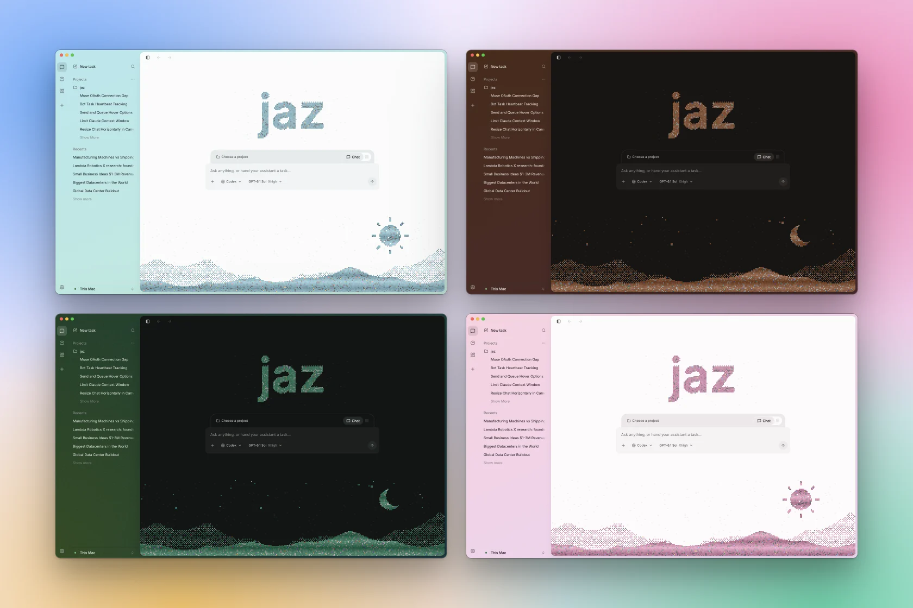

## Get Started

Grab the latest desktop build from [**Releases**](https://github.com/gluonfield/jaz/releases/latest),
or [run it from source](#development).

Jaz runs seven coding agents over [ACP](https://agentclientprotocol.com), and you pick one per thread:

| Agent | Provider | Sign in with |
|---|---|---|
| **Codex** | OpenAI | ChatGPT plan, or OpenAI or OpenRouter API key |
| **Claude Code** | Anthropic | Claude Pro/Max plan, or Anthropic API key |
| **Kimi Code** | Moonshot AI | kimi.ai account |
| **Antigravity** | Google | Google account |
| **Grok** | xAI | Grok account, or xAI API key |
| **Muse Code** | Meta | Meta account, or Meta API key |
| **OpenCode** | Open source | OpenRouter or OpenAI API key |

## Features

- **Pick the agent per thread** — any agent in the table above.
- **Loops** — scheduled prompts that run overnight.
- **Boards** — multi-window dashboards of live artifacts.
- **Memory** — survives the thread.
- **Ship from the thread** — built-in git control.
- **MCP servers & skills**, token-usage tracking, and an always-on mode for 24/7 work.

## Architecture

Client/server split — the backend owns everything, clients are control surfaces.
By default you run both together on your own machine; the backend can also live on a
remote server you connect to over HTTP.

- **Backend** (`backend/`, Go) — the always-on core. Runs agent sessions, loops,
  memory, and tools; owns your credentials and workspaces. REST + SSE; drives agents
  over [ACP](https://agentclientprotocol.com) and tools over MCP.
- **Desktop** (`frontend/`, Electron + React) — the control surface. Runs the backend
  locally by default, or connects to a remote one over HTTP with a per-device token.

Running the backend on a server: see [`docs/remote-backend.md`](docs/remote-backend.md).

## Development

Requirements: **Go 1.26**, **Bun 1.3.5**.

Backend:

```sh
cd backend
OPENROUTER_API_KEY=... go run ./cmd/jaz   # serves on :5299
go test ./...
```

Desktop app:

```sh
cd frontend
bun install
bun run dev                               # JAZ_API_URL=https://host to target a remote backend
bun run lint && bun run typecheck
bun run build                             # package the desktop app
```

Cutting a release: [`docs/RELEASE.md`](docs/RELEASE.md).

## Author

**Augustinas Malinauskas** — [@amgauge](https://x.com/amgauge) · [amguage.com](https://amguage.com)

## License

[Apache 2.0](LICENSE).
