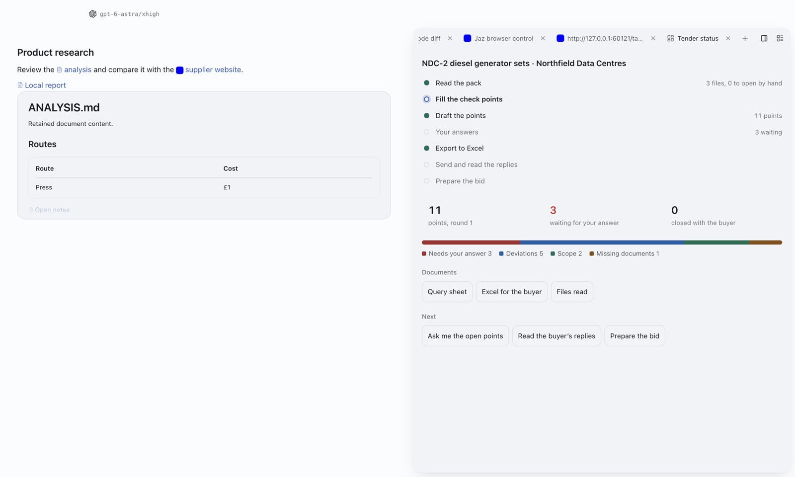

# Proposal: a tenders plugin for Sterling Green in Jaz

Build it as a plugin: a folder of skills, a few views and one script, kept in a Sterling Green repository and installed into Jaz from there. The skills turn a tender folder into three files in the thread's folder: a tender brief, a query sheet the rep edits in the side panel, and an Excel file in the buyer's template. Jaz already has most of what this needs; five gaps are listed below. The repository and a first version of the plugin now exist. A dedicated review screen, as in the earlier mocks, comes after the trial and only if the document proves too slow to check.

## What the sample data shows

The folder holds two real purchase-stage packs with the sheets that were sent, and the team's check-points sheet ([sample folder](https://drive.google.com/drive/folders/1J6NjopLQUjPFOCfe0wEAOPUnLN1pNSwh)).

- **A query sheet is one row per point, with a column per round.** Adani's has 44 points, each with the document, clause, the buyer's clause text and the query, then Adani's response, Sterling's reply of 9 Feb and the meeting minutes of 20 Feb ([Adani sheet](https://docs.google.com/spreadsheets/d/1Hcy8ysTe4ifPiQ9ZDKx6KZA5O2FE6gIv)).
- **The buyer sets the format.** PDG's sheet is PDG's own form, "Addendum to RFP" IMS-TPL-PRC-19, with different columns ([PDG sheet](https://docs.google.com/spreadsheets/d/1fwUlR5Fi52YDVkHpNLEEq7DVPXGVYHnS)). The export has to fill the buyer's file, not ours.
- **Open points are repeated in later rounds.** PDG's sheet has 132 rows, but the load-bank point appears three times (rows 33, 45 and 129), each with a newer reply ([PDG sheet](https://docs.google.com/spreadsheets/d/1fwUlR5Fi52YDVkHpNLEEq7DVPXGVYHnS)). Round handling is part of the job, not an extra.
- **Half the points do not come from the specification.** In Adani's sheet 19 of 44 points cite the price schedule, 13 the generator specification and 6 the commissioning summary. In PDG's, 63 of 132 cite the special conditions, 15 the test scripts and 7 the bill of quantities (counted from both sheets). Reading only the specification PDF would miss about half.
- **The check-points sheet is the method.** It lists 77 points in 12 categories with Sterling's "Offered Specification" filled in and a "Tender Requirement" column left empty for each tender ([Standard Check Points](https://docs.google.com/spreadsheets/d/1u1aS8YvSR1mAXKZH8J133pblwwZ_wTWM)). Real queries are these lines restated:
  - Insulation class H where class F was asked (check points 32–33, PDG point 13).
  - 50 mm Rockwool where 75 mm was asked (check point 60, Adani point 9).
  - 25 dB insertion loss against a 75 dB(A) limit (check point 40, Adani point 3).
- **Points fall into five kinds** (my reading of both sheets):
  - a deviation that states our standard;
  - a scope question;
  - a document the tender refers to but did not include;
  - a contradiction between two documents;
  - a commercial term passed to procurement.
- **Not in the sample:** the product matrix, data sheets, the common-remarks sheet, lead-stage sheets and any non-data-centre pack, all promised on the 13 Nov call ([16:06 session](https://notes.granola.ai/d/e4e8b0d2-6083-483f-ac88-4bf6ecf774a5)).

## The plugin

The plugin is a folder in a private repository for Sterling Green work, [`gluonfield/sg`](https://github.com/gluonfield/sg), which now exists. The repository holds only what gets installed. The Drive data is used to write and correct the skills and is not copied into it.

```
gluonfield/sg
└── plugins/
    ├── tenders/
    │   ├── plugin.json  name, title, description, version
    │   ├── skills/      query-sheet, bid-preparation
    │   ├── views/       question.html, status.html
    │   ├── scripts/     read the pack, export to Excel, status
    │   ├── reference/   check points, positions taken before, how points are written, document format
    │   └── examples/    an invented tender with a worked sheet
    └── …                later plugins
```

| Skill | When it runs | What it writes in the thread's folder |
|---|---|---|
| **query-sheet** | A tender arrives, or the buyer replies to a sheet already sent | `check-points.md`: what this tender asks beside each of Sterling's 77 standard offers. `query-sheet.md`: the points, carried through every round. `query-sheet.xlsx`: the same in the buyer's form. `status.json`, which the status view draws. |
| **bid-preparation** | The queries are settled and the offer is being assembled | `brief.md`, a checklist of every form the buyer wants with the offer, the compliance and deviation statement, the buyer's data sheet with Sterling's values, and scope notes for whoever prices. It leaves every rate blank. |

Later rounds are part of `query-sheet`, not a separate skill: the same sheet continues when the buyer replies.

The two sample packs are the worked examples. Their tender files show what comes in, and the sheets that were sent show what should come out: the columns, the wording and how much to ask. The skills are written from them and corrected by running on them.

## What the first trial showed

A fresh agent followed `query-sheet` on each sample pack without seeing the sheet that was sent, and each draft was then compared with that sheet (drafts and comparisons are in the repository's ignored `runs/` folder).

| | Adani | PDG |
|---|---|---|
| Matters in the sheet Sterling sent | 44 | 72 (133 rows with repeats) |
| Points in the draft | 93 | 90 |
| Sent matters the draft raised | 37 | 43, and 7 unclear |
| Sent matters the draft missed | 7 | 22 |
| Draft points the engineers never raised | 56 | 48 |

- **The draft asked twice as much as the team does.** The excess was the same on both tenders: commercial clauses, mismatches between documents that change nothing built, documents not needed for pricing, and how the site is run.
- **The team states; the draft asked.** Sent points have a median of 10 to 21 words against the draft's 36 to 45, and many are flat statements such as "110% overload not allowed" or "Not in our scope".
- **The team includes or excludes; the draft offered options.** "Quoted as a separate item" appeared 25 times in the drafts and never in a sent sheet.
- **Most differences in position were things the plugin did not know.** Sterling's stance on batteries, leak detection, load steps, makes and scope is in the sent sheets but not in the 77 check points. About 20 such differences came up per tender.
- **What was missed came from small lines:** test steps the set cannot follow, missing pass limits, small scope items such as scaffolding and convenience outlets, and "not applicable" declarations.

The skills are corrected for each of these: a test for raising a point, a list of what to leave out, the team's wording, and a new reference file of positions Sterling has taken, drawn from the two sent sheets.

## The document on the right

Use a Markdown document in Jaz's editable reader, with one section per point instead of one wide table. Excel stays the delivery format and is generated from the document.

```markdown
## Needs your input (3)

### 6 · Price Schedule, item 5 · day tank fittings
> Supply, installation, testing and commissioning of 990 liters double skin
> day tank … as shown in P&ID drawing

**Query:** Please share the P&ID drawing so we can count the level
transmitters and switches. Leak detection is normally part of the HSD
package; please confirm.

Kind: missing document · Check point 51 · [Price Schedule, item 5](Tender/BOQ/price-schedule.xlsx)
```

- **Why sections:** seven columns of paragraph-length text do not fit a side panel, and a section can hold the whole history of a point across rounds. The sample rows have a median query of 124 characters and clause texts of several hundred (counted from the Adani sheet).
- **Why Markdown:** the rep and the agent edit the same file. The reader saves only edited lines, asks when both changed the same text, and follows the agent's writes while it works (`components/document/DocumentEditor.tsx`, in Jaz since tag v0.0.265).
- **Order replaces filters:** points needing the rep's answer come first, then deviations, scope, missing documents, commercial terms, and last the points left out on purpose.
- **Checking is the team's stated worry** ([12:06 session](https://notes.granola.ai/d/757a4898-e09f-4a09-8b20-acd10b504f86)), so every point links to its source page and names the check point it rests on.

The alternative is a plugin view in the side panel: a sheet with filters and accept, edit and drop buttons, as in the mocks. It is the better review tool, but it is a separate app to build and host, with its own database of tenders, the way Jaz CRM and Jaz Tasks are separate apps that Jaz connects to. Skills need none of that.

## How a plugin works in Jaz

This part is built on the task branch and not yet merged or released.

**A plugin is a folder.** `plugin.json` names it; `skills/` holds its skills, `views/` its interface as plain HTML files, and `scripts/` and `reference/` what the skills use. Jaz keeps installed plugins in `~/.jaz/plugins` and offers their skills to every agent, beside the user's own ([`plugins.go`](../backend/internal/plugins/plugins.go), [`skills.go`](../backend/internal/skills/skills.go)).

**A skill shows a view by name.** The agent has one new tool, `show_view`, and passes a view's name and what to draw, never the HTML ([`tools.go`](../backend/internal/plugins/tools.go)):

| Call | Where it appears | Used for |
|---|---|---|
| `view: "tenders/question"`, `data: {…}` | A card in the conversation | A point that needs the rep's decision: the clause, Sterling's standard and the choices. The click comes back to the thread as the rep's answer. |
| `view: "tenders/status"`, `file: "status.json"` | A tab in the side panel | Where the tender stands. The tab opens by itself when the skill shows it and redraws whenever the file changes, without reloading ([`ViewPanel.tsx`](../frontend/src/renderer/src/components/session/ViewPanel.tsx)). |

A view runs in Jaz's existing sandboxed frame with the app's colours and fonts. It reads `window.data`, hears later versions through `window.onData`, sends a message to the thread with `sendPrompt` and opens a file from the thread's folder beside itself with `openLink`.



The status view above is the plugin's own file drawing the mock tender's `status.json`, captured in Jaz's hidden test window; the left half is the test's placeholder thread.

**The flow for a tender:**

1. The rep starts a thread, attaches the tender folder and asks for the query sheet.
2. The skill reads the pack and shows the status view. It stays in the side panel for the rest of the work.
3. The skill fills the check points and drafts `query-sheet.md`. After each step it reruns `status.py`, and the view moves on.
4. For each point that needs a decision, a question card appears in the conversation. The rep clicks an answer, or opens the query sheet from the status view and edits it directly.
5. The status view's buttons ask for the next step: export to Excel, read the buyer's replies, prepare the bid.

## What Jaz needs

- [x] **Show a plugin's view with data.** `show_view`, above.
- [x] **Keep a plugin's view open in the side panel.** The view tab, above.
- [x] **Install and remove plugins.** Settings → Plugins, next section.
- [x] **Release editable documents.** Cell-edited tables and the document toolbar are in tag v0.0.265.
- [ ] **Ship plugins with a Jaz build.** See the next section.
- [ ] **Open a source at its page.** The side panel shows PDFs and spreadsheets, but a link cannot carry a page or a cell: the PDF view takes only the file ([`FileReaderPanel.tsx:113`](../frontend/src/renderer/src/components/session/FileReaderPanel.tsx)). This is the largest saving on checking time.
- [ ] **Show the source beside the sheet.** The side panel shows one tab at a time ([`sidePanelTabs.ts`](../frontend/src/renderer/src/lib/sidePanelTabs.ts)), so opening a reference hides the sheet. A split, or a peek over the document, keeps both in view.
- [ ] **Let the agent open a document in the side panel.** Today a document opens when the rep clicks its card or a button in the status view.
- [ ] **`show_view` for Jaz's own agent.** The tool is offered to the coding agents Jaz runs (Claude, Codex and the others); Jaz's built-in agent does not have it yet.

The pack itself can already come from a Drive folder link: this proposal's sample was listed and downloaded through the Drive connection. Sterling works in Outlook and Teams ([12:06 session](https://notes.granola.ai/d/757a4898-e09f-4a09-8b20-acd10b504f86)), which Jaz does not connect to.

## Installing a plugin

**From Settings.** Settings → Plugins lists what is installed, with each plugin's skills and views, and has an **Add plugin** button; a zip can also be dropped on the page ([`PluginsSettings.tsx`](../frontend/src/renderer/src/components/settings/PluginsSettings.tsx)). The zip can be one plugin's folder or a whole repository as GitHub downloads it: every folder with a `plugin.json` is installed, and a newer zip replaces the plugin of the same name. Removing is one click.

**By hand.** The same thing is copying the folder: `plugins/tenders` into `~/.jaz/plugins`.

**Later, shipped with Jaz.** A Jaz build can already carry per-customer defaults for appearance and agents (`jaz-defaults.js`), but not plugins. To package a Jaz version with its required plugins, the build would include the plugin folders and Jaz would read them beside `~/.jaz/plugins`. Nothing has to be downloaded or signed in to, and the plugin's version is the build's version. Not built.

Installing from a repository address is not proposed for now. Today's start-up download of the built-in skills, from a list compiled into Jaz ([`app.go:82`](../backend/internal/app/app.go)), stays as it is.

## Build order

- [x] Pack reading, check points and the query sheet, tried on the Adani and PDG packs.
- [x] Export into both buyers' forms, including PDG's form inside its nine-sheet RFP workbook.
- [x] The question card and the status view.
- [x] Corrections from the first trial.
- [ ] A second trial on a tender the plugin has not seen. The two samples can no longer test it, because the positions file is built from their sent sheets.
- [ ] Later rounds, tried on PDG's repeated points.
- [x] In Jaz: plugins as installable folders, views shown by name with data, the side-panel view tab, Settings → Plugins. On the task branch.
- [x] A mock tender, so the flow can be shown without a buyer's documents.
- [ ] One whole run in the real app with the mock tender: install, ask for the sheet, answer the cards.
- [ ] In Jaz: plugins shipped with a build, page links and the source beside the sheet.
- [ ] Run beside the team on the four live West tenders.

## Decisions needed

- [ ] **Document shape:** sections per point (my recommendation) or a table that mirrors the Excel columns.
- [ ] **Skills, two views and files to start** (my recommendation), with the separate review app from the mocks decided after the trial.
- [ ] **Who runs it in the trial:** CAS on copies of the packs (my recommendation), or Sterling's reps on their own machines, which waits on IT's answer about sending tenders to a cloud model ([12 Nov session](https://notes.granola.ai/d/8bb336da-7986-48f6-9dfd-4f7c8beeaf17)).
- [ ] **Data still to get from Sterling:** product matrix, data sheets, common-remarks sheet, a lead-stage sheet and a non-data-centre pack. The trial makes the first three the most valuable: they are where Sterling's positions live.
